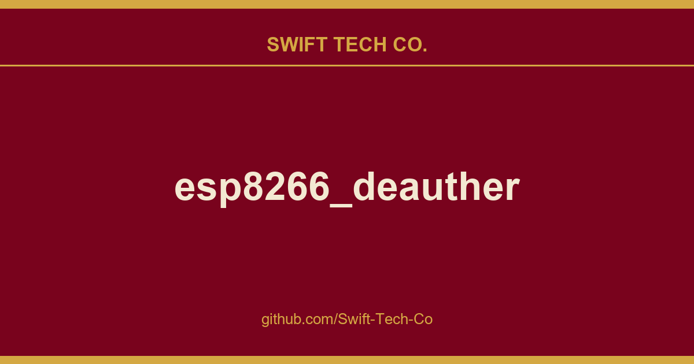

# esp8266_deauther

## What This Is

A practical reference entry for product and engineering: the esp8266_deauther notes, examples and fixes we reach for repeatedly. Kept current as part of the wider Swift Tech Co. engineering library.

## Images

## New Documentation

Hi 👋  
Please visit Deauther.com for information about this project.  
Here are some quick links:

* Buy
* Download
* DIY Tutorial
* Usage
* FAQ

## Password

The password for `pwned` is `deauther`

## About this Project

This firmware allows you to easily perform a variety of actions to test 802.11 networks using an ESP8266. It's also a great project for learning about WiFi, microcontrollers, Arduino, hacking and electronics/programming in general.  

The deauthentication attack is the main feature, which can be used to disconnect devices from their WiFi network.  
Although this denial-of-service attack is nothing new, a lot of devices are still vulnerable to it. Luckily this is slowly changing with more WiFi 6 enabled devices being used. But a lot of outdated WiFi devices remain in place, for example in cheap IoT hardware.
With an ESP8266 Deauther, you can easily test this attack on your 2.4GHz WiFi network/devices and see whether it's successful or not. And if it is, you know you should upgrade your network.

## Disclaimer

This project is a proof of concept for testing and educational purposes.  
Neither the ESP8266, nor its SDK was meant or built for such purposes. **Bugs can occur!**  

**Use it only against your own networks and devices!**  
Please check the legal regulations in your country before using it.  
We don't take any responsibility for what you do with this program.

---

## Swift Tech Co.

Built and maintained by Swift Tech Co.

AI Automation | FinTech Platforms | Custom Software and Mobile Apps | SaaS Platforms | Cloud Infrastructure | Cybersecurity | SEO and Marketing | API Integration

**Join our community on Telegram:** [t.me/+Qt_eFvkb2rliMzNh](https://t.me/+Qt_eFvkb2rliMzNh)

Home | Services | Careers | Referral Program | Influencers | About | Contact

**Connect**

- Website: https://github.com/Swift-Tech-Co/esp8266_deauther
- LinkedIn: [linkedin.com/in/stephenoladoke](https://www.linkedin.com/in/stephenoladoke/)
- LinkedIn (Company): [linkedin.com/company/swift-tech-co](https://www.linkedin.com/company/swift-tech-co)
- X: [@MrOladoke](https://x.com/MrOladoke)
- Instagram: [@mr.oladoke](https://www.instagram.com/mr.oladoke/)
- Organization: [github.com/Swift-Tech-Co](https://github.com/Swift-Tech-Co)

## Sources

Compiled and maintained from upstream [SpacehuhnTech/esp8266_deauther](https://github.com/SpacehuhnTech/esp8266_deauther) under permissive open-source license.

---

Maintained by [Swift Tech Co.](https://github.com/Swift-Tech-Co) - [Telegram](https://t.me/+Qt_eFvkb2rliMzNh)

## Sources

Compiled and maintained from upstream [SpacehuhnTech/esp8266_deauther](https://github.com/SpacehuhnTech/esp8266_deauther) under permissive open-source license.

---

Maintained by [Swift Tech Co.](https://github.com/Swift-Tech-Co) - [Telegram](https://t.me/+Qt_eFvkb2rliMzNh)

## Sources

Compiled and maintained from upstream [SpacehuhnTech/esp8266_deauther](https://github.com/SpacehuhnTech/esp8266_deauther) under permissive open-source license.

---

Maintained by [Swift Tech Co.](https://github.com/Swift-Tech-Co) - [Telegram](https://t.me/+Qt_eFvkb2rliMzNh)

## Sources

Compiled and maintained from upstream [SpacehuhnTech/esp8266_deauther](https://github.com/SpacehuhnTech/esp8266_deauther) under permissive open-source license.

---

Maintained by [Swift Tech Co.](https://github.com/Swift-Tech-Co) - [Telegram](https://t.me/+Qt_eFvkb2rliMzNh)